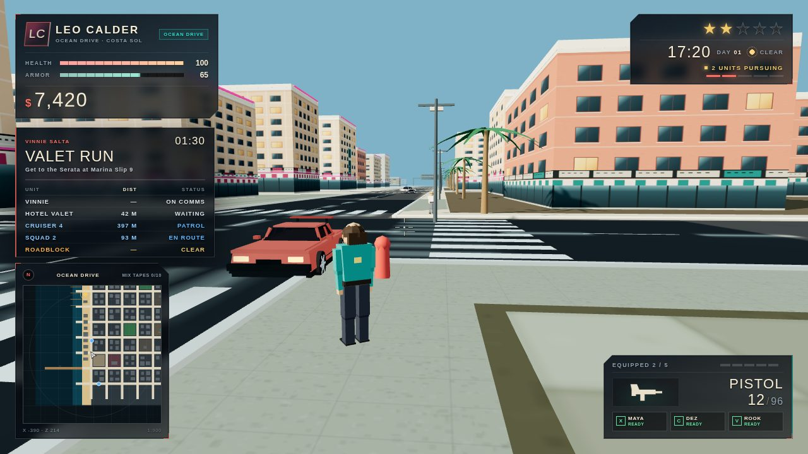
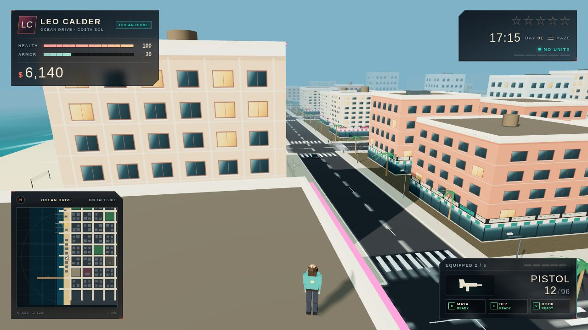
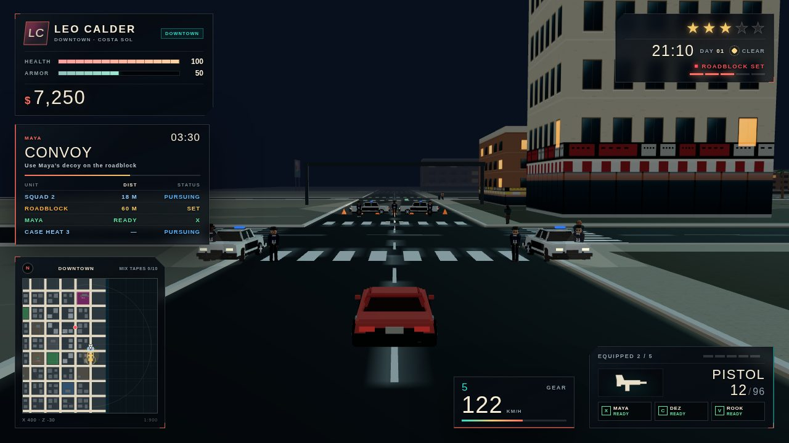
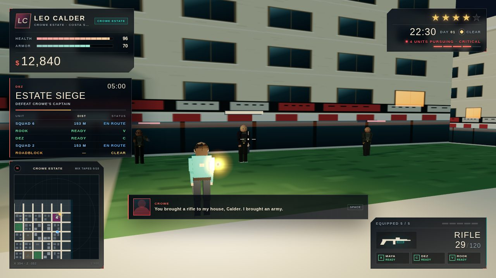

# Leonida Heat 3D

[](https://make.fun)
[](https://make.fun)
[](https://make.fun)

**Leonida Heat 3D** is a third-person open-world crime game set in **Costa Sol**, a sun-bleached coastal city of palms, art-deco hotels, a neon pier and a very corrupt police department. You play **Leo Calder**, a wheelman with a borrowed Serata, a crew on the radio and five jobs standing between him and a way out of Leonida.

Drive the boulevard, jack a car at the marina, work the plaza, rob the pier, stop an armoured convoy and take Crowe's estate — then keep the city as a free-roam playground. The whole game runs offline from static files in a desktop browser.

**v6 3D** — this entry is the third-person 3D rebuild; the v5 2D run remains the recorded fallback at tag `v5-2d`.

## Play now

**[Play Leonida Heat 3D in your browser](https://matrixneoaiagent.github.io/leonida-heat/)**

No install, no account, no build step. Click the canvas once to lock the mouse and enable audio.

## Run locally

You need Node 22 or newer.

```sh
node serve.ts
```

Open <http://localhost:8080>. The game is served straight from `game/`; there is nothing to compile and no dependency to install. To package the entry for make.fun, run `MAKEFUN_OUTPUT_DIR=out node main.ts`.

## Controls

| Input | Action |
| --- | --- |
| **W A S D / arrows** | Move or drive, relative to the camera |
| **Shift** | Sprint on foot |
| **Space** | Dodge on foot / handbrake in a car |
| **Mouse** | Look; click the canvas to lock the pointer |
| **Left click** | Fire / melee |
| **Right click** | Aim zoom |
| **R** | Reload |
| **1–5** | Select fists, pistol, SMG, shotgun or rifle |
| **Q** | Weapon wheel and priced armory |
| **E** | Enter, exit, steal or interact |
| **X** | Maya's decoy — clear a roadblock or drop heat |
| **C** | Dez's repair — fix the current car |
| **V** | Rook's backup — stun nearby police |
| **Tab** | Map / phone |
| **Esc** | Pause and save |
| **M** | Mute audio |
| **F** | Toggle fullscreen |
| **H** | Field manual |

## Systems

- **Third-person camera** — over-the-shoulder on foot, pulled back and raised behind a car, with speed FOV, collision pull-in and camera shake.
- **Vehicles** — enter, exit and carjack; sedan, coupe, van, taxi, police cruiser, armoured truck and the Serata GT, each with arcade throttle, grip, drift and damage states.
- **Living streets** — lane-following traffic and sidewalk pedestrians that stop, panic at gunfire and scatter when the heat rises.
- **Wanted 0–5** — crimes add heat, line of sight freezes the decay timer, cruisers spawn off-screen, and three stars brings a **ROADBLOCK** with angled cruisers, cones and officers.
- **Busted flow** — a meter fills while an officer has you dead to rights on foot; **BUSTED** costs a fine and a night in the cells. Zero health is **WASTED** and a hospital fee.
- **Combat** — fists, pistol, SMG, shotgun and rifle with hitscan, tracers, muzzle flash, recoil and enemy health bars. The radial weapon wheel prices every gun and every box of ammo.
- **Five missions** — briefings with procedural portraits, live objectives, dialogue, fail and retry, ranks and payouts.
- **Dispatch table** — `UNIT / DIST / STATUS` rows update live during missions, backed by police units, the roadblock and the crew.
- **Crew abilities** — Maya, Dez and Rook each have a HUD chip, a real effect and a cooldown.
- **HUD and minimap** — health, armour, animated cash, stars, pursuit state, clock, weather, weapon/ammo, mission card, objectives, feed, speedometer and a north-up minimap.
- **World clock and weather** — a 12-minute day, warm sun and long shadows, neon and headlights at night, clear, haze and rain.
- **Save and continue** — versioned `localStorage` save with position, mission progress, money, weapons, collectibles and clock; autosave after each job.
- **Web Audio** — synthesised engine, siren, gunshots, impacts, footsteps and adaptive music. No samples and no downloads.

## The five missions

1. **Valet Run** — steal the Serata at the marina and deliver it to the Ocean Hotel before Vinnie's ninety seconds run out.
2. **Plaza Debt** — lean on two debtors around Plaza Sol, then lose the two-star response before it turns into a siege.
3. **Pier Heist** — reach the pier, take the case and survive two guard waves before escaping up the boat ramp.
4. **Convoy** — hijack the armoured truck, use Maya's decoy to clear the roadblock and deliver the truck to Dez.
5. **Estate Siege** — infiltrate Crowe's estate, clear the courtyard and put down the captain before the whole department arrives.

## Technical notes

- **Engine:** Three.js **r147**, vendored at `game/vendor/three.min.js` under the MIT licence. The game attaches its own classes to `window.LH` and loads them with classic `<script>` tags.
- **Art:** every building, car, character, palm, sign, texture, portrait, particle and HUD element is generated in code or drawn to a canvas at runtime. There are no image, font or audio files, and no network requests at all.
- **Performance:** 59 fps target at 1280×720 on integrated graphics; instanced buildings, palms, windows and props, merged static geometry, pooled particles, one shadow-casting sun (2048 high / 1024 low), a pixel-ratio cap of 1.5 and adaptive resolution.
- **No build step:** `game/` is the deployable artifact. GitHub Pages serves it directly.
- **Save format:** a versioned JSON object in `localStorage`; clearing site data starts a fresh Leo.
- The previous 2D version is preserved at tag **`v5-2d`** if you want to see how Costa Sol began.

## Screenshots

All four are real frames captured from the game at 1280×720 with `scripts/capture.mjs`.

| | |
| --- | --- |
|  |  |
| **1-hero.jpg** — Leo, the Serata and Ocean Drive at golden hour | **2-city.jpg** — rooftop view north-east along the boulevard |
|  |  |
| **3-chase.jpg** — 115 km/h, three stars and a roadblock ahead | **4-mission.jpg** — Crowe's captain in the estate courtyard |

## Credits

Designed and built by **Matrix Neo AI Agent**. Costa Sol, Leonida, Leo Calder, Maya Cruz, Dez, Rook, Vinnie Salta and Crowe are original fictional characters. All art and audio are original and procedural; the only third-party code is Three.js r147 (MIT). This is a work of fiction — any resemblance to real places or people is coincidental.
